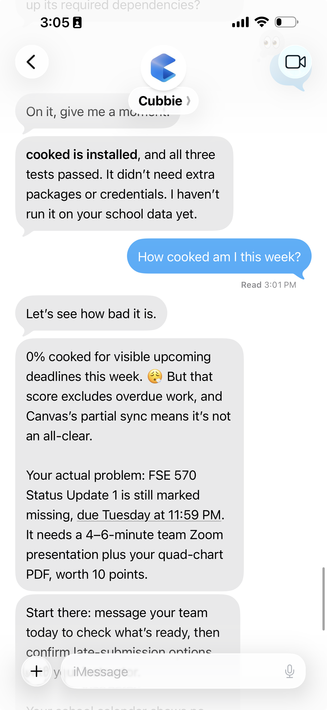

<div align="center">

# 🔥 cooked

### Find your hell week before it finds you.

Know how cooked you are, what's colliding, and what to do first.<br>
A semester rescue skill for **Cubbie**, right inside **iMessage**.


[See it in iMessage](#see-it-in-imessage) · [Try the demo](#try-it-in-60-seconds) · [Install in Cubbie](#install-in-cubbie)

</div>

We built cooked at DevHacks after one of us checked Canvas at 11pm and found **three exams in four days**.

The deadlines were there all along. The collision was easy to miss. Cooked brings assignments across classes into one view, weighs what's at stake, and turns the busiest week into a plan you can actually follow.

## See it in iMessage

<p align="center">
  <a href="docs/screenshot.png">
    
  </a>
</p>

<p align="center"><sub>Real Cubbie test on student data. Tap the screenshot to view it at full size.</sub></p>

**A low score still needs context.** In this conversation, Cubbie calls out overdue work and incomplete Canvas data alongside the upcoming score, then gives the student a concrete first step.

## What a conversation looks like

```text
you: how cooked am i

cubbie: checking your canvas 👀

cubbie: you're 78% cooked 😬 because nov 17-20 has MAT 266 midterm (15%), CHM 233 exam (12%) and ENG 102 essay (8%) in one week

cubbie: start with the MAT midterm, it's the biggest piece of that week and it hits first. three things in four days, you didn't make a schedule, you made a speedrun

cubbie: how ready are you for the MAT midterm? 1 not started, 2 some, 3 solid

you: 1

cubbie: want me to save you?

you: yes

cubbie: here's the plan, 3 hrs a day max:
- mon nov 9, 2-4pm: MAT midterm practice, Hayden Library
- tue nov 10, 7-8:30pm: CHM exam review
- wed nov 11, 3-4pm: MAT office hours
- thu nov 12, 1-3pm: essay outline at the MU
...
add these to your calendar?
```

## From “am I cooked?” to “here's the plan”

| Step | What cooked does |
| --- | --- |
| **1. Spot the collision** | Reads Canvas deadlines and grade weights, plus exam dates available in a syllabus. Finds the seven days with the most grade weight landing at once. |
| **2. Explain the score** | Runs the Python scorer and shows which assignments drive the result, with their share of each course grade. Text **“how did you get that score?”** for the math in 2 sentences. |
| **3. Ask how ready you are** | Asks one question about the top priority: 1 not started, 2 some, 3 solid. Re-scores with your answer and says if the score moved. |
| **4. Pick the first move** | Ranks upcoming work by grade share and time remaining, with a reason for the top priorities. |
| **5. Make room to recover** | Uses free time in Google Calendar to propose study blocks, capped at **3 hours a day**. Asks before adding them. |
| **6. Keep the plan honest** | Offers an opt-in nightly debrief: what you got done, the next 48 hours, the updated score, and a proposed new slot for missed blocks. |

A little personality comes with the help:

> “3 exams in 4 days. you didn't make a schedule, you made a speedrun”

The roast stays about the schedule. Above 85% cooked, the tone gets gentler and the help comes first.

### When you fall behind

Every night (9pm unless you pick another time), cooked checks Canvas for what's new or turned in since last time and your calendar for which study blocks already passed. If it can't tell, it asks. Then you get one text: what you got done, what's due in the next 48 hours, your new score, and what to do next.

If you skipped a block, it says so. No “great job today!” when you didn't do anything. It moves the block to your next free slot, asks before touching your calendar, and tells you if hell week just got worse.

## Try it in 60 seconds

**Python 3.12. Standard library only. No package installation or connected accounts needed for the sample.**

```bash
git clone https://github.com/SrujanRudrapati/cooked.git
cd cooked
python3 cooked/scripts/score.py --sample
python3 cooked/scripts/test_score.py
```

The bundled sample uses **November 6, 2026** as a fixed date, so the demo is reproducible. Its result:

| Cooked score | Hell week | First priority | Study effort in the next 14 days |
| :---: | :---: | :--- | :---: |
| **78% 😬** | **Nov 17–20** | **MAT 266 · midterm 2** | **17.1 hours** |

That collision contains the MAT midterm (**15%** of its course grade), CHM exam (**12%**), and ENG essay (**8%**). The scorer returns the full JSON: score breakdown, collision, priorities, effort estimates, overdue work, and warnings. The six included tests cover larger projects outweighing small quizzes, submitted work being excluded, an empty schedule scoring zero, readiness lowering the score, out-of-range readiness being rejected, and counting items on default weights.

## Install in Cubbie

1. Connect **Canvas** to Cubbie. Connect **Google Calendar** to let it plan around your availability.
2. Text Cubbie this skill link:

   ```text
   https://github.com/SrujanRudrapati/cooked/tree/main/cooked
   ```

3. Text **“how cooked am I”**.
4. Say yes to **“want me to save you?”** to see a study plan. Review it before approving calendar changes.

Without Google Calendar, cooked can still score your semester and give you a plan as text. Nightly check-ins are optional; choose a time, or text **“pause debriefs”** to stop them.

## Why the score means something

**Two big projects should matter more than three tiny quizzes.** Each assignment contributes its percentage of the course grade. The scorer finds the seven-day window with the largest combined load:

```text
item load      = share of course grade × readiness factor
hell_week_load = sum of item loads in the heaviest 7-day window
base score     = min(100, round_half_up(100 × hell_week_load / 45))
urgency bonus  = +10 if that week starts within 10 days
                 +5 more if it starts within 3 days
cooked score   = min(100, base score + urgency bonus)
```

In the sample, **15 + 12 + 8 = 35** percentage points of load. **35 / 45 × 100 → 78%**, with no urgency bonus because the week starts 11 days away.

Weights come from the item's explicit grade share, then its points divided by total course points, then a default by type: exam 20%, project 15%, essay 10%, quiz 3%, homework 2%, other 3%. The score is a workload heuristic that adds percentage points across courses; it caps at 100. If more than a third of your items fall back to a default weight, or the Canvas sync is incomplete, Cubbie adds one short caveat line, once. It never repeats it in later texts.

**Things you're ready for count less.** Readiness 1 (not started) counts fully, 2 (some) counts 70%, and 3 (solid) counts 40%. No answer counts as 1. In nightly debriefs, finished study blocks count the same way: at least one block done is 2, all of an item's blocks done is 3, and it never goes below what you said.

Submitted items are excluded. Unsubmitted overdue items are reported separately. Effort estimates scale by assignment type and grade share to help size study blocks.

**Every cooked score comes from [`score.py`](cooked/scripts/score.py).** Cubbie handles the conversation and connected tools; Python handles the arithmetic.

## Built to be inspectable

```text
Canvas + syllabus → assignment data → Python scorer → score + priorities
Google Calendar   → available time  → Cubbie        → proposed study plan
```

This repo contains the skill instructions, scoring engine, sample data, and tests. Cubbie supplies the assistant runtime and connected services; the skill defines how to use them together.

| File | Purpose |
| --- | --- |
| [`cooked/SKILL.md`](cooked/SKILL.md) | Conversation flow, planning rules, nightly debriefs, and guardrails. |
| [`cooked/scripts/score.py`](cooked/scripts/score.py) | Grade-weighted scoring, collision detection, priorities, and effort estimates. |
| [`cooked/assets/sample_items.json`](cooked/assets/sample_items.json) | Reproducible demo with assignments across four courses. |
| [`cooked/scripts/test_score.py`](cooked/scripts/test_score.py) | Six tests for core scoring behavior, readiness, and default weights. |

<details>
<summary><strong>Run the scorer with your own data</strong></summary>

Save a JSON list as `items.json`:

```json
[
  {"course": "CHM 233", "title": "exam 2", "type": "exam", "due": "2026-11-18", "weight_pct": 20},
  {"course": "MAT 266", "title": "midterm 2", "type": "exam", "due": "2026-11-17", "points_possible": 90, "course_total_points": 600}
]
```

From the repository root, run:

```bash
python3 cooked/scripts/score.py --input items.json --today 2026-11-06
```

Use today's date in your time zone for your own schedule. See [`SKILL.md`](cooked/SKILL.md#the-items-file) for the full item format.

</details>

## Current limits

- **Data quality:** missing weights fall back to defaults. Canvas gaps and syllabus-only dates need a second look.
- **Coverage:** work outside Canvas needs to be supplied through a syllabus or the input data.
- **Course differences:** pass/fail classes still count by grade share, and group projects are planned as individual work.
- **Student control:** calendar additions and moves require approval. Cooked never completes or submits graded work.
